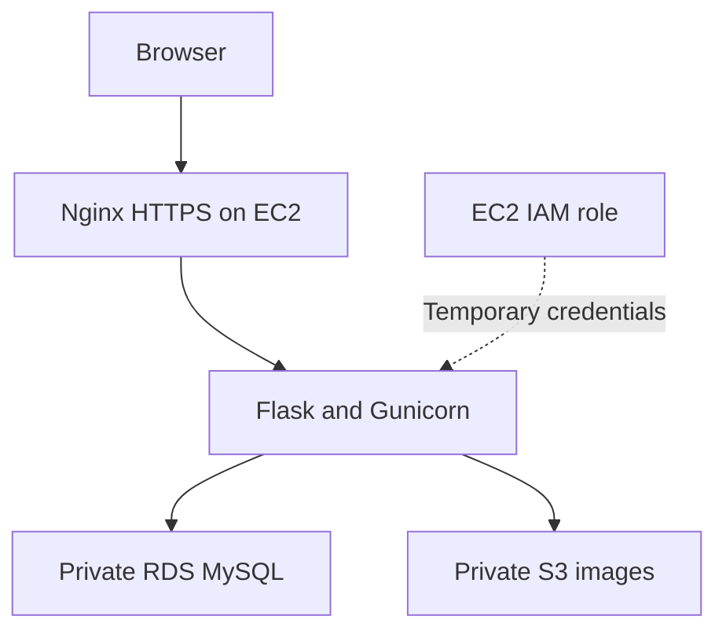

# AWS Community Events

A reconstructed event listing web application with image uploads. It runs locally without AWS and has an AWS deployment path using EC2, RDS MySQL, S3 and an EC2 IAM role.

## Background

This is **new code prepared in November 2026**, based on earlier coursework discussions involving EC2, RDS, S3 image uploads and PHP files named `functions.php` and `view_events.php`. The original complete source code was not recovered. The event-management scope and Flask implementation are reconstruction choices; this repository is not the original submission or evidence of a completed live deployment.

## What it does

- Public event listing with dates, locations and images
- Password-protected administrator access
- Event creation and deletion
- Image validation, resizing and metadata removal through re-encoding
- Local SQLite and file storage for development
- RDS MySQL over verified TLS and private S3 storage for AWS
- Form CSRF protection, parameterised database queries and escaped templates
- Automated tests and a GitHub Actions workflow

## Architecture



The database stores event text and an image object key. The server uploads images to S3 and serves images through an event-specific route. The bucket remains private. Public event images are intentionally visible through the website.

## Run locally

Requires Python 3.10 or newer. The preparation environment used Python 3.12.

```bash
python -m venv .venv
```

Activate it on Windows:

```powershell
.venv\Scripts\Activate.ps1
```

Or on Ubuntu/macOS:

```bash
source .venv/bin/activate
```

Then:

```bash
python -m pip install -r requirements-dev.txt
python configure_local.py
flask --app app run
```

Choose an administrator password when asked. Open http://127.0.0.1:5000 and select **Admin sign in**. SQLite and uploaded files are created in `instance/`. Both are ignored by Git, along with the private `.env` file. Do not enable debug mode on a public server.

`requirements.txt` contains version ranges; `requirements-lock.txt` records the exact dependency versions in the preparation environment, including the test tools.

## Test

```bash
python -m pytest -q
```

At preparation, **13 tests passed**. They exercise public pages, authentication, CSRF, event validation, HTML escaping, local image upload/read/delete, invalid uploads, missing resources, failed-write cleanup and mocked S3 operations. No real AWS credentials are required.

RDS connections, IAM permissions, Nginx, systemd and live S3 operations have not been integration-tested in AWS. The UI has not undergone full browser acceptance testing. See the live verification checklist before deployment.

## AWS deployment

Read [the deployment guide](docs/AWS_DEPLOYMENT.md). It includes network boundaries, private storage, database schema, environment configuration, EC2 role permissions, systemd and an HTTPS reverse proxy. Deployment can incur AWS charges; no resources are created by this repository automatically.

## Repository contents

| File/folder | Purpose |
| --- | --- |
| `app.py` | Routes, validation, authentication and database/storage adapters |
| `templates/`, `static/` | Responsive web interface |
| `configure_local.py` | Generates private local configuration |
| `tests/` | Pytest suite |
| `deploy/` | MySQL schema, IAM policies, service and Nginx examples |
| `docs/AWS_DEPLOYMENT.md` | AWS setup and live checks |
| `.env.example` | Placeholder configuration, without real secrets |

## Limits

This is a portfolio demonstration with one administrator. Event creation and deletion are implemented; editing, account management and advanced search are not. Dates use Europe/London wall time. Login rate limiting is supplied in the deployment Nginx example rather than the local development server. Do not run this demo publicly without the documented HTTPS, database and access configuration.
